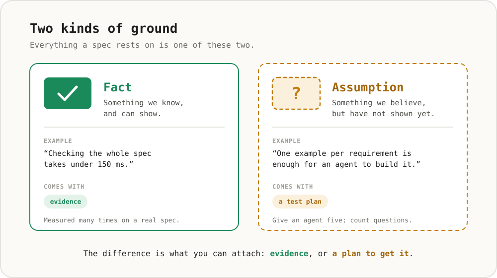
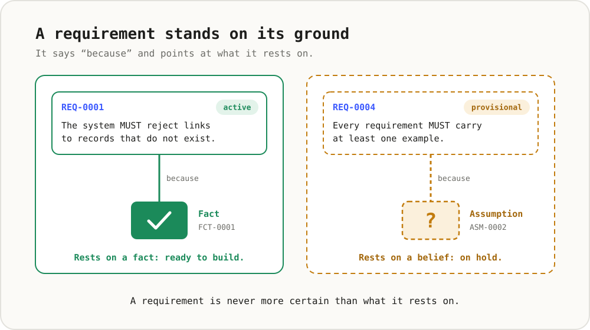
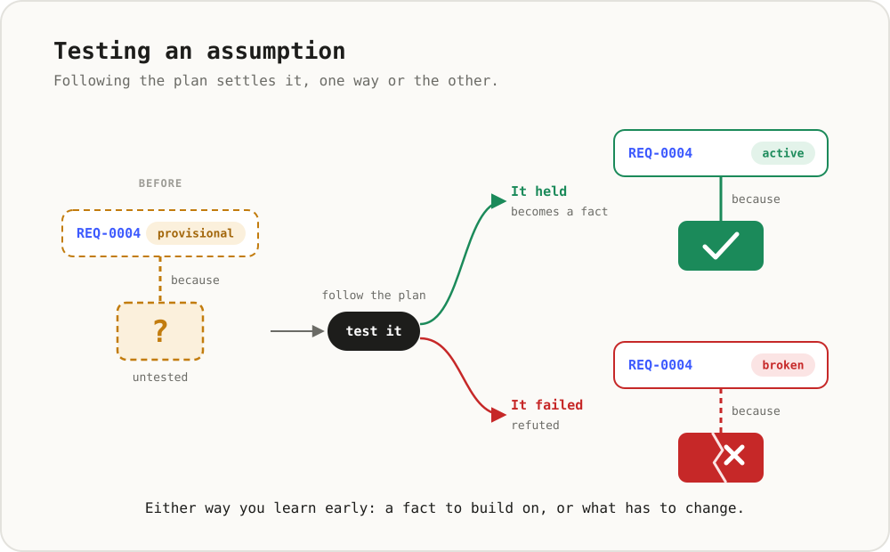
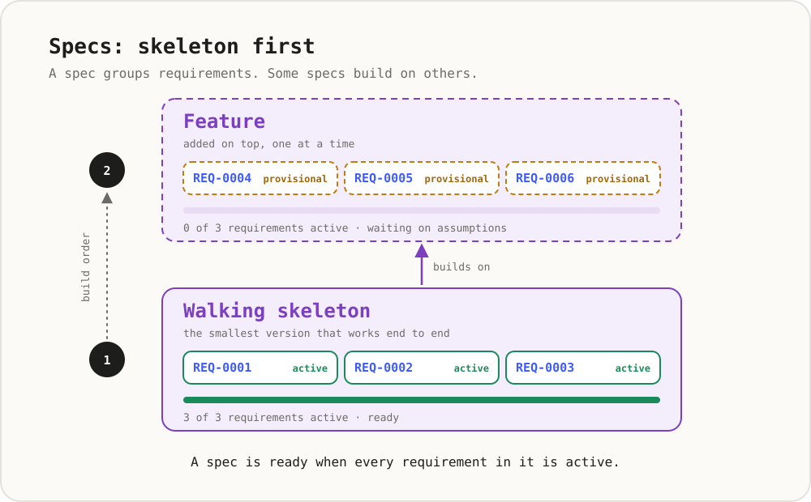
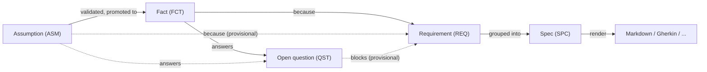

# ASDLC Meta-Specs

[](https://github.com/jvanheerikhuize/asdlc-meta-specs/actions/workflows/check.yml)

Specs for agentic software development that are **honest about what they know**.

Most specs mix verified truths with guesswork and never say which is which. Here, every requirement says *because* and names the **facts** or **assumptions** it rests on. What nobody can answer yet is written down as an **open question**, so the gap is visible instead of guessed. A check makes sure that no requirement is more certain than its grounds.

> **Facts → requirements → specs.**

This is the simplified version of the original engine, which is kept in the [`target_state`](https://github.com/jvanheerikhuize/asdlc-meta-specs/tree/target_state) branch. It keeps the same principles with 5 record types instead of 10 and one script instead of a toolchain.

## How it works, in six pictures

Each picture adds one idea to the one before.











## The axiom

**Facts → requirements → specs.** A requirement holds only if the facts it rests on hold, and a spec holds only if its requirements hold. A spec is therefore never more certain than the least certain thing underneath it, and an unanswered question is less certain than any assumption, because there is not even a guess to test. Everything else in this repo (the `because` links, the open questions, the provisional/broken statuses, the impact trace) follows from this.

It is an axiom, so it is stated here to be checked, not taken on faith:

- **Facts → requirements (theory).** Zave & Jackson define a requirement as satisfied only when the specification *and* the domain knowledge about its environment both hold ("Four dark corners of requirements engineering", ACM TOSEM 6(1), 1997). A system can meet its spec and still fail if a fact about the world is wrong. van Lamsweerde separates domain properties from assumptions that are "too ideal" and must be analysed ([obstacles, TSE 2000](https://webperso.info.ucl.ac.be/%7Eavl/files/TSE-Obstacles.pdf)). These correspond to `FCT` and `ASM` here.
- **Facts → requirements (incidents).** In NASA's Voyager and Galileo software, safety-related errors came mostly from misunderstood or missing requirements and mistaken assumptions about the environment ([Lutz 1993](https://ntrs.nasa.gov/citations/20060042270)). Ariane 5 flight 501 failed on an Ariane 4 assumption about horizontal velocity that was never re-checked against Ariane 5 trajectory data ([inquiry report summary](https://en.wikipedia.org/wiki/Ariane_flight_V88)).
- **Requirements → specs and outcomes.** Across 228 companies, incomplete and underspecified requirements were among the most reported problems, and moving targets correlated most with failure ([NaPiRE](https://arxiv.org/abs/1611.10288)). For code-generating models, resolving ambiguous requirements first raised GPT-4's pass rate from 70.96% to 80.80% ([ClarifyGPT, FSE 2024](https://arxiv.org/abs/2310.10996)).
- **Limits.** The evidence for the second arrow in agent-driven development is benchmark data, not field data, so treat it as an assumption still being tested. The often-quoted claim that late fixes cost 100× more is *not* part of the grounding: a study of 171 projects found no consistent delayed-issue effect ([Menzies et al. 2016](https://arxiv.org/abs/1609.04886)).

## The whole model



| Record | Means | Statuses |
| :--- | :--- | :--- |
| `ASM` Assumption | Something we believe but have not proven, with a plan to validate it | `open` → `validated` (promoted to a fact) or `invalidated` |
| `FCT` Fact | Something we know, with `evidence` | `active`, `deprecated` |
| `QST` Question | A gap with no candidate answer yet. It `blocks` requirements or specs until it is `answered_by` a fact or assumption | `open` → `answered` |
| `REQ` Requirement | What the system MUST/SHOULD do, `because` of facts/assumptions, with Given/When/Then acceptance | `provisional`, `active`, `broken` |
| `SPC` Spec | A group of requirements, either the walking `skeleton` or a `feature` on top of it | `draft`, `active` |

## Six principles

1. **Facts vs. assumptions.** A requirement resting on an open assumption is `provisional`. If that assumption is refuted, the requirement is `broken`. Only requirements resting on facts can be `active`.
2. **Gaps are questions, not guesses.** When nobody can propose an answer, write an open question instead of an assumption made up to fill the hole. It keeps what it blocks `provisional`, and rendered specs list it next to the requirement, so an implementing agent asks instead of guessing.
3. **Atomic records.** One file per record in `records/`, with a stable ID and links in YAML front matter. This gives clean diffs, no merge conflicts, and files agents can read easily.
4. **Standard-agnostic.** The records are the source of truth. OpenSpec, Spec Kit, Gherkin and the like are *renderings* of them, and each needs only a small function.
5. **Tech-stack agnostic.** Records describe behaviour, never products. Naming a framework or database triggers a warning, and strict mode fails on it.
6. **Skeleton first.** A small `skeleton` spec delivers the end-to-end core, and `feature` specs `depends_on` it. When a fact changes, `impact` lists the specs to rebuild in that order.

## Usage

```bash
pip install -r requirements.txt
python tools/spec.py check --strict          # links, epistemic gates, open questions, spec DAG
python tools/spec.py impact FCT-0001         # what to revisit when FCT-0001 changes
python tools/spec.py render --tier skeleton  # write dist/SPC-*.md
python tools/spec.py render --format gherkin # write dist/SPC-*.feature
python tools/spec.py index                   # write site/data/index.json for the workspace
python -m unittest discover -s tests         # one test per acceptance scenario
```

Example output:

```text
18 records · 0 errors · 0 warnings
  SPC-0001 [skeleton] 100% ready  Record graph and epistemic check
  SPC-0002 [feature ]   0% ready  Rendering and guardrails
```

## Workspace (GitHub Pages)

**https://jvanheerikhuize.github.io/asdlc-meta-specs/** is a small static site in `site/` (one HTML page, one script, no build step). It is rebuilt and deployed on every push to `main`.

- **Dashboard:** the state of the spec at a glance. Each record type gets a bar coloured green (done), amber (needs attention) or red (broken), and every segment links to those records. Below it: the specs that need attention and exactly what blocks them, and the open questions and assumptions that hold things back, questions first.
- **Tasks:** what a human must do next, worked out from the records: *fix now* (broken requirements, check errors), *answer questions* (with "we know → record the fact" and "we have a guess → record the assumption" buttons), *test assumptions* (ranked by what they unlock, with "it held → record the fact" and "it failed → mark invalidated" buttons), *quick wins* (requirements or specs that can be activated) and *tidy up*.
- **Graph:** assumptions → facts → questions → requirements → specs. Solid edges rest on facts, dashed edges on open assumptions and open questions. Click a record to trace its lineage.
- **Records:** filter by type, search, and open any record to see its text, what it rests on, what uses it and what a change would affect.
- **Capture:** a form per record type. It picks the next free ID, shows the file, and opens GitHub's editor with it filled in. Choose "create a new branch and start a pull request" and CI checks the record. There is no bot or ingest pipeline.

Local preview: `python tools/spec.py index && python -m http.server -d site 8000`.

To enable Pages on a fork: *Settings → Pages → Source: GitHub Actions*.

## Adding a record

Copy a record of the same type, take the next free ID, name the file `<ID>-<slug>.md`, and run `check`.

```markdown
---
id: REQ-0008
title: Short, behavioural title
status: provisional          # open assumption in `because` → provisional
because: [FCT-0001, ASM-0002]
---

## Statement
The system MUST ...

## Acceptance
- Given ...
- When ...
- Then ...
```

To **validate an assumption**: add a `FCT` with `evidence` and `promoted_from: ASM-xxxx`, then set the assumption to `status: validated` with `promoted_to: FCT-xxxx`. The check then asks dependent requirements to cite the fact instead, after which they can become `active`.

To **ask a question**: add a `QST` with `status: open` and `blocks: [REQ-xxxx]`. Everything it blocks stays `provisional` (requirements) or `draft` (specs) until it is answered. To **answer** it, record the answer as a fact or an assumption, set the question to `status: answered` with `answered_by: <that ID>`, and add the answer to the `because` of each requirement it blocked. The workspace lists these edits for you.

## This repo specifies itself

The records in [`records/`](records/) are the spec for this repository. The skeleton (`SPC-0001`) is fully grounded in facts and `active`. The feature spec (`SPC-0002`) is still `draft`, because its requirements rest on three open assumptions and one open question (`QST-0002`: which formats do the agent tools we target actually read?). That is the point: the spec shows where its own knowledge stops.

## Layout

```text
records/          all records, one file each (ASM, FCT, QST, REQ, SPC)
tools/spec.py     check · impact · render · index
site/             the Pages workspace (index.html, app.js, styles.css)
docs/concepts/    the six pictures above
ROADMAP.md        from this starting point to the target state
tests/            one test per acceptance scenario
```

## Roadmap

This repository is the starting point. The full original engine is kept in the [`target_state`](https://github.com/jvanheerikhuize/asdlc-meta-specs/tree/target_state) branch, and [ROADMAP.md](ROADMAP.md) explains how to grow towards it: one evidence-backed step at a time.
