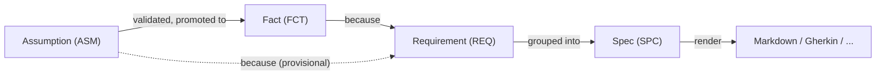

# ASDLC Meta-Specs Lite

[](https://github.com/jvanheerikhuize/asdlc-meta-specs-lite/actions/workflows/check.yml)

Specs for agentic software development that are **honest about what they know**.

Most specs mix verified truths with guesswork and never say which is which. Here, every requirement says *because* and names the **facts** or **assumptions** it rests on. A check makes sure that no requirement is more certain than its grounds.

> **Better facts → better requirements → better specs.**

This is the simplified version of [asdlc-meta-specs](https://github.com/jvanheerikhuize/asdlc-meta-specs). It keeps the same principles with 4 record types instead of 10 and one script instead of a toolchain.

## The whole model



| Record | Means | Statuses |
| :--- | :--- | :--- |
| `ASM` Assumption | Something we believe but have not proven, with a plan to validate it | `open` → `validated` (promoted to a fact) or `invalidated` |
| `FCT` Fact | Something we know, with `evidence` | `active`, `deprecated` |
| `REQ` Requirement | What the system MUST/SHOULD do, `because` of facts/assumptions, with Given/When/Then acceptance | `provisional`, `active`, `broken` |
| `SPC` Spec | A group of requirements, either the walking `skeleton` or a `feature` on top of it | `draft`, `active` |

## Five principles

1. **Facts vs. assumptions.** A requirement resting on an open assumption is `provisional`. If that assumption is refuted, the requirement is `broken`. Only requirements resting on facts can be `active`.
2. **Atomic records.** One file per record in `records/`, with a stable ID and links in YAML front matter. This gives clean diffs, no merge conflicts, and files agents can read easily.
3. **Standard-agnostic.** The records are the source of truth. OpenSpec, Spec Kit, Gherkin and the like are *renderings* of them, and each needs only a small function.
4. **Tech-stack agnostic.** Records describe behaviour, never products. Naming a framework or database triggers a warning, and strict mode fails on it.
5. **Skeleton first.** A small `skeleton` spec delivers the end-to-end core, and `feature` specs `depends_on` it. When a fact changes, `impact` lists the specs to rebuild in that order.

## Usage

```bash
pip install -r requirements.txt
python tools/spec.py check --strict          # links, epistemic gates, spec DAG, readiness
python tools/spec.py impact FCT-0001         # what to revisit when FCT-0001 changes
python tools/spec.py render --tier skeleton  # write dist/SPC-*.md
python tools/spec.py render --format gherkin # write dist/SPC-*.feature
python -m unittest discover -s tests         # one test per acceptance scenario
```

Example output:

```text
14 records · 0 errors · 0 warnings
  SPC-0001 [skeleton] 100% ready  Record graph and epistemic check
  SPC-0002 [feature ]   0% ready  Rendering and guardrails
```

## Adding a record

Copy a record of the same type, take the next free ID, name the file `<ID>-<slug>.md`, and run `check`.

```markdown
---
id: REQ-0007
title: Short, behavioural title
status: provisional          # open assumption in `because` → provisional
because: [FCT-0001, ASM-0002]
---

## Statement
The system MUST ...

## Acceptance
- Given ...
- When ...
- Then ...
```

To **validate an assumption**: add a `FCT` with `evidence` and `promoted_from: ASM-xxxx`, then set the assumption to `status: validated` with `promoted_to: FCT-xxxx`. The check then asks dependent requirements to cite the fact instead, after which they can become `active`.

## This repo specifies itself

The records in [`records/`](records/) are the spec for this repository. The skeleton (`SPC-0001`) is fully grounded in facts and `active`. The feature spec (`SPC-0002`) is still `draft`, because its requirements rest on three open assumptions. That is the point: the spec shows where its own knowledge stops.

## Layout

```text
records/          all records, one file each (ASM, FCT, REQ, SPC)
tools/spec.py     check · impact · render
tests/            one test per acceptance scenario
```
