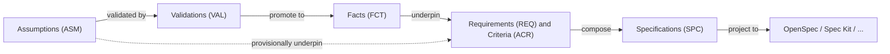
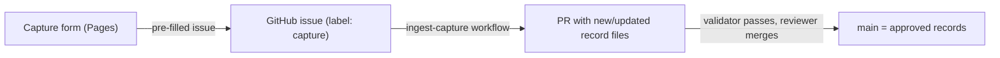

# ASDLC Meta-Specs

[](https://github.com/jvanheerikhuize/asdlc-meta-specs/actions/workflows/validate.yml)

A **standard-agnostic, epistemic specification repository** for Agentic Software Development Life Cycles (ASDLC) and Specification-Driven Development (SDD).

Instead of monolithic spec documents that silently mix verified truths with guesswork, this repository breaks specifications down into **atomic, linkable elemental records** governed by an explicit **epistemic feedback loop**:



> **Better facts → better requirements → better specs.**

---

## Core Philosophy

1. **Epistemic Transparency (Facts vs. Assumptions)**
   Every normative element — Constraint (`CON`), Requirement (`REQ`), Acceptance Criterion (`ACR`), or Decision (`DEC`) — links to the **Facts (`FCT`)** and/or **Assumptions (`ASM`)** that underpin it. The validator enforces that:
   - records underpinned by unvalidated assumptions cannot be `active` (they must be **provisional**);
   - records underpinned by an invalidated assumption or deprecated fact must be **broken** / **needs_review**;
   - records still pointing at a *promoted* assumption are flagged for review against the resulting fact.

2. **Atomic Elemental Records**
   Each record is one Markdown file with strict YAML frontmatter in `records/`. This gives clean Git diffs, no merge conflicts between unrelated requirements, stable ID addressing, and easy parsing by AI agents and future capture UIs.

3. **Standard-Agnostic Projections**
   External SDD formats — **OpenSpec**, **GitHub Spec Kit**, EARS, Gherkin, ADRs — are treated as **target projections** (`adapters/` → `dist/`) of the canonical record graph.

4. **Tech-Stack Agnostic Specifications (PIM vs. PSM)**
   Canonical specifications (`SPC`, `CHG`), requirements (`REQ`), acceptance criteria (`ACR`), constraints (`CON`), decisions (`DEC`), and domain assumptions/facts (`ASM`, `FCT`) are **strictly tech-stack agnostic**. They express domain behavior, architectural topology, and invariants without locking in specific databases, frameworks, wire protocols, or cipher suites (which are defined externally and bound during projection). `tools/validate.py` and the capture workspace actively warn against tech-stack leakage.

---

## Quickstart

```bash
pip install -r tools/requirements.txt
python tools/validate.py                        # schema, links, reciprocity, epistemic consistency, readiness
python tools/validate.py --strict               # also fail on warnings
python tools/project.py                         # compile canonical records into dist/openspec and dist/speckit
python tools/project.py --check                 # verify dist/ projections are in sync with canonical records
python -m unittest discover -s tests -v         # run capture ingestion, projection & index unit tests
python tools/build_index.py                     # compile records into site/data/index.json
```

**Adding a record manually:** copy an existing record of the same type, take the next free ID (e.g. `REQ-0004`), name the file `<ID>-<kebab-slug>.md`, fill in the frontmatter, and run `python tools/validate.py`. Dates must be quoted strings (`created_at: "2026-10-27"`).

---

## Repository Architecture

```text
asdlc-meta-specs/
├── meta-spec.config.yaml              # ID prefixes, directories, schemas, epistemic rules, adapters
├── schema/                            # JSON Schemas (Draft 2020-12) for record frontmatter
│   └── captures/                      # Strict schemas for untrusted capture payloads
├── records/                           # Canonical atomic store (source of truth)
│   ├── epistemic/
│   │   ├── assumptions/               # ASM-xxxx: unverified hypotheses
│   │   ├── validations/               # VAL-xxxx: spikes, benchmarks, interviews, evidence
│   │   ├── facts/                     # FCT-xxxx: verified truths & promoted assumptions
│   │   └── questions/                 # QST-xxxx: open questions & clarifications
│   └── normative/
│       ├── constraints/               # CON-xxxx: project guardrails & invariants
│       ├── requirements/              # REQ-xxxx: atomic functional & non-functional requirements
│       ├── criteria/                  # ACR-xxxx: testable acceptance scenarios
│       └── decisions/                 # DEC-xxxx: architectural & design decisions
├── specs/
│   ├── capabilities/                  # SPC-xxxx: capability manifests composing records
│   └── changes/                       # CHG-xxxx: delta proposals (added / modified / removed)
├── adapters/                          # Mapping rules & templates per target standard
│   ├── openspec/
│   └── speckit/
├── dist/                              # Projected standard outputs compiled by tools/project.py
├── site/                              # GitHub Pages workspace (plain HTML/CSS/ES modules, no build step)
├── tools/
│   ├── recordlib.py                   # shared record parsing / writing
│   ├── validate.py                    # schema, links, epistemic consistency, readiness
│   ├── project.py                     # projection compiler (adapters/ + records/ -> dist/)
│   ├── build_index.py                 # records → site/data/index.json (built in CI)
│   └── ingest_capture.py              # capture issue (or payload file) → new/updated record files
├── tests/                             # unit tests + fixtures for ingestion & index
├── .github/
│   ├── ISSUE_TEMPLATE/                # capture-{requirement,assumption,fact,decision,question} issue forms
│   └── workflows/                     # validate · ingest-capture · pages (gated)
└── docs/                              # Architecture, lifecycle & mapping guides
```

---

## GitHub Pages Workspace

`site/` is a small, framework-free web app that serves as the human-facing workspace: dashboard, interactive **Record Graph** (`#/graph`), record browser, prose + local traceability view per record (`#/record/:id`), pending captures, and **capture interfaces** — all inside one persistent shell (header, navigation, search, draft indicators).

### Exploring the Record Graph

Open **Browse → Graph** (`#/graph`) to inspect how assumptions, validations, open questions, and verified facts underpin constraints, requirements, acceptance criteria, decisions, and specifications:

- **Stratified 5-tier flow:** Columns map directly to the epistemic lifecycle (`1 · Hypotheses & Evidence` → `2 · Verified Truths` → `3 · Normative Core` → `4 · Verification & Design` → optional `5 · Composition`).
- **Epistemic edge styling:** Solid green edges show verified facts underpinning active requirements; dashed amber edges highlight provisional links from unvalidated assumptions or open questions.
- **Lineage & risk lenses:** Click any node to trace its full upstream grounding and downstream impact in the side inspector, filter by domain, isolate a single record's lineage, or spotlight open epistemic risks. Every record page (`#/record/:id`) also embeds a local 1–2 hop traceability mini-graph.

### Capturing records (Requirement, Assumption, Fact & validation, Decision, Open question)



1. Open any topic under **Capture** in the sidebar:
   - **Requirement (`#/capture/requirement`):** *what should the system do* + *why* (existing facts/assumptions or new reasons, plus optional Given/When/Then scenarios).
   - **Assumption (`#/capture/assumption`):** *what we assume is true* + *how we will validate it* (plus risk, initial confidence, and optional links to dependent `REQ`/`CON`/`DEC` records).
   - **Fact & validation (`#/capture/fact`):** record a standalone verified `FCT`, or select an open `ASM-xxxx` to **promote** (`confirmed`/`refined` → mints `VAL` + `FCT` and marks `ASM` `promoted`) or **refute** (`refuted` → mints `VAL`, marks `ASM` `invalidated`, and cascades `broken`/`needs_review` onto dependent records).
   - **Decision (`#/capture/decision`):** record an architectural/design choice (`DEC`), the `REQ`/`CON` records it satisfies, the `FCT`/`ASM` records that justify it, and considered alternatives/trade-offs.
   - **Open question (`#/capture/question`):** record an unresolved behavioral or domain ambiguity (`QST`), the `REQ`/`CON`/`DEC`/`SPC`/`CHG` records it `affects`, whether it is `blocking: true` (which cascades `provisional` onto affected active records), and candidate options.
2. **Submit** opens the matching GitHub Issue Form with every field pre-filled (you can still edit them there); click *Create*. Drafts autosave in the browser per capture topic.
3. The `ingest-capture` workflow allocates IDs, writes/updates the record files, validates the full graph, and opens a PR that closes the issue.
4. **Approval = one approving review + merge.** A ruleset on `main` requires one approval from a collaborator with write access (the PR is opened by the bot, so any collaborator — including the capturer — can approve it). Approvals are dismissed if the capture is edited and the PR re-pushed. Repository admins can bypass.

Without the app you can use the issue forms directly (*New issue → Capture a requirement / assumption / fact / decision / question*). Only repository owners/members/collaborators can trigger ingestion.

### Enabling the site

Deployment is **off by default**. To enable:

1. *Settings → Pages → Source:* **GitHub Actions**.
2. *Settings → Secrets and variables → Actions → Variables:* add `PAGES_ENABLED` = `true`.
3. Push to `main` (or run the *pages* workflow manually).

> [!WARNING]
> Pages sites are public unless you're on GitHub Enterprise Cloud — even for private repositories. Set `site.publish: "metadata"` in `meta-spec.config.yaml` to omit record prose from the published index.

Local preview: `python tools/build_index.py && python -m http.server -d site 8000`.

---

## Elemental Record Prefix Reference

| Prefix | Layer | Type | Description |
| :--- | :--- | :--- | :--- |
| **`ASM`** | Epistemic | `assumption` | Unverified belief with explicit `confidence`, `risk`, and `validation_plan`. |
| **`VAL`** | Epistemic | `validation` | Experiment, benchmark, test, or citation that `tests` an assumption or `establishes` a fact. |
| **`FCT`** | Epistemic | `fact` | Verified truth or invariant (native, or `promoted_from` an `ASM` via a `VAL`). |
| **`QST`** | Epistemic | `question` | Open question or clarification (`blocking`, `affects`, `resolved_by`). |
| **`CON`** | Normative | `constraint` | Project principle, compliance boundary, or architectural invariant. |
| **`REQ`** | Normative | `requirement` | Atomic normative statement (`MUST`/`SHALL`/`SHOULD`/`MAY`). |
| **`ACR`** | Normative | `criterion` | Testable scenario (`GIVEN`/`WHEN`/`THEN` or assertion) verifying a `REQ`. |
| **`DEC`** | Normative | `decision` | Design choice / ADR satisfying `REQ`s and `CON`s. |
| **`SPC`** | Composition | `spec` | Capability specification assembling `CON`, `REQ`, `ACR`, `DEC` records. |
| **`CHG`** | Composition | `change` | Delta proposal adding, modifying, or removing records. |

---

## Project Status

| Area | Status |
| :--- | :--- |
| Record model, schemas, folder architecture | ✅ In place (`10` record schemas + `5` capture schemas) |
| Canonical records (`auth`, `global`, `onboarding`, `performance`) | ✅ In place (`18` records across all `10` elemental types) |
| Validator, unit tests + CI | ✅ In place (`validate.py` incl. tech-stack agnosticism checks + `23` unit tests in `tests/test_ingest.py`) |
| Projection compiler (`adapters/` → `dist/`) | ✅ In place (`tools/project.py` with `--check` and `--stack-profile` support) |
| Pages workspace shell (dashboard, records, prose, pending) | ✅ In place — deploy gated behind `PAGES_ENABLED` |
| Interactive Record Graph (`#/graph`) & per-record mini-graph | ✅ In place |
| Requirement, Assumption, Fact & validation, Decision, and Open Question capture (app → issue → PR) | ✅ In place |
| Planned record types (`TRM`, `CTR`) & in-app PR review | 🔜 Planned ([see Roadmap](docs/roadmap.md)) |

---

## Documentation

- **[Architecture & Data Model](docs/architecture.md)** — record graph, frontmatter conventions, traceability & tech-stack agnosticism rules.
- **[Epistemic Lifecycle](docs/epistemic-lifecycle.md)** — capturing assumptions, validating, promoting to facts, cascading updates.
- **[Standard Mappings](docs/standard-mappings.md)** — how records project into OpenSpec, Spec Kit, EARS, and Gherkin.
- **[Roadmap & Planned Evolution](docs/roadmap.md)** — PIM vs. PSM separation, planned tech-stack-agnostic records (`TRM`, `QST`, `CTR`), schema enrichments, and projection tooling.
