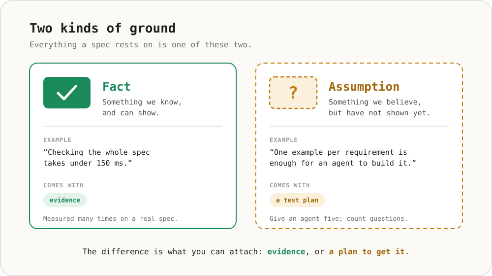
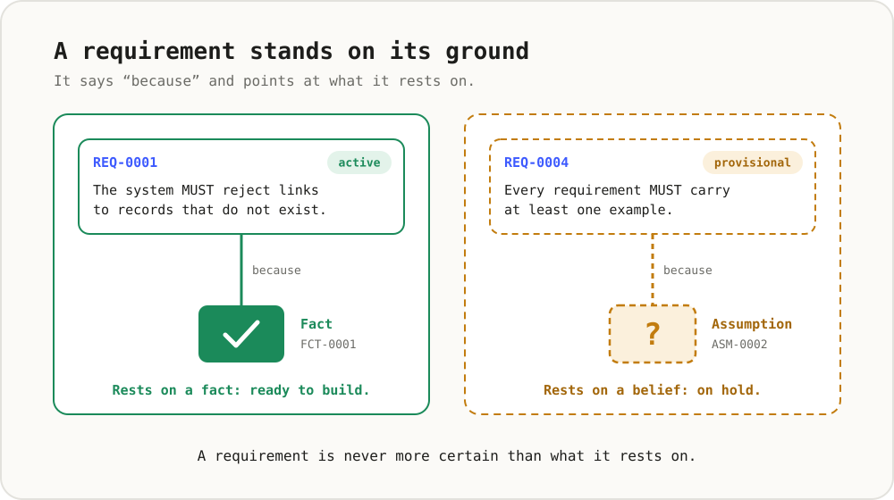
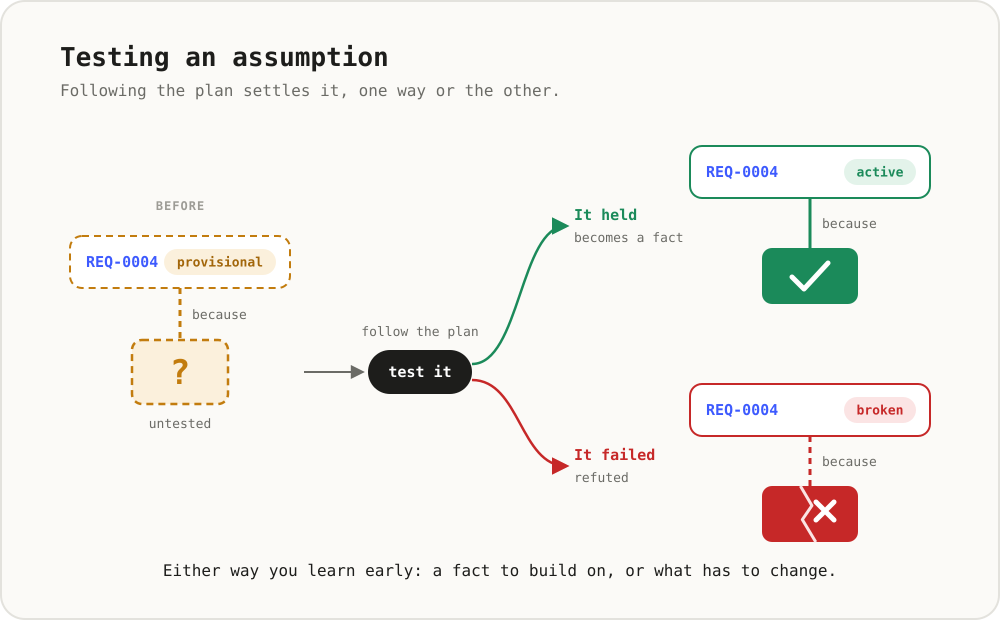
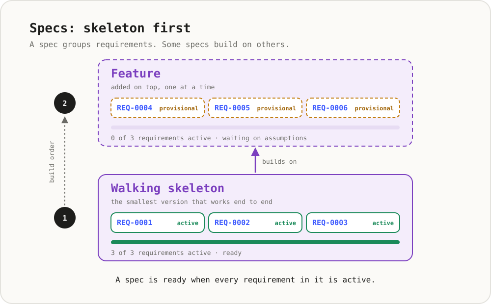
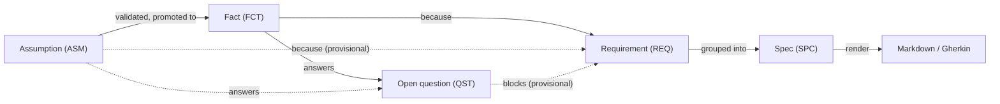

# ASDLC Meta-Specs

[](https://github.com/jvanheerikhuize/asdlc-meta-specs/actions/workflows/check.yml)

Specs for agentic software development that are **honest about what they know**.

> **Facts → requirements → specs.**

Most specs mix verified truths with guesswork. Here, every requirement says **`because`** and links to the **facts** or **assumptions** it rests on. Unknowns with no candidate answer yet are recorded as **open questions** so agents ask instead of guessing. One script (`tools/spec.py`) checks that no requirement or spec is marked more certain than its grounds.

## How it works, in six pictures











## The model

Five atomic Markdown record types in `records/`, linked via YAML front matter:



| Record | What it is | Allowed statuses | Key fields |
| :--- | :--- | :--- | :--- |
| `FCT` Fact | Verified truth about the domain or system | `active`, `deprecated` | `evidence`, `promoted_from` |
| `ASM` Assumption | A belief we have not proven yet, with a test plan | `open`, `validated`, `invalidated` | `confidence`, `promoted_to` |
| `QST` Question | A known gap with no candidate answer yet | `open`, `answered` | `blocks`, `answered_by` |
| `REQ` Requirement | Behavioural `MUST`/`SHOULD` + Given/When/Then scenarios | `provisional`, `active`, `broken` | `because` |
| `SPC` Spec | Group of requirements (`skeleton` or `feature` tier) | `draft`, `active` | `tier`, `requirements`, `depends_on` |

### Rules enforced by `tools/spec.py check --strict`

1. **Honest grounds:** A `REQ` resting on an open `ASM` or blocked by an open `QST` must be `provisional`. If its `FCT` is `deprecated` or its `ASM` is `invalidated`, it must be `broken`. Only requirements resting strictly on `active` facts can be `active`.
2. **Gaps are questions, not guesses:** Open `QST` records block requirements and specs until `answered_by` a `FCT` or `ASM`.
3. **Stack-agnostic records:** Records describe behaviour, never frameworks, languages, databases, or vendors. Keep concrete technology choices in a separate `TECH_STACK.md`.
4. **Skeleton first:** `skeleton` specs cannot depend on `feature` specs, spec dependencies must be acyclic, and a spec can be `active` only when 100% of its requirements are `active`.

### Why this axiom?

- **Domain facts vs. assumptions:** Requirements hold only when domain properties hold ([Zave & Jackson 1997](https://doi.org/10.1145/237432.237434); [van Lamsweerde 2000](https://webperso.info.ucl.ac.be/%7Eavl/files/TSE-Obstacles.pdf)). Unchecked assumptions drive real failures ([Lutz 1993](https://ntrs.nasa.gov/citations/20060042270); [Ariane 501](https://en.wikipedia.org/wiki/Ariane_flight_V88)).
- **Clarifying before coding:** Incomplete requirements top industry failure surveys ([NaPiRE](https://arxiv.org/abs/1611.10288)), and resolving ambiguity before code generation raises LLM pass rates from 70.96% to 80.80% ([ClarifyGPT, FSE 2024](https://arxiv.org/abs/2310.10996)).

## Quick start

```bash
pip install -r requirements.txt
python tools/spec.py check --strict          # validate links, statuses, DAG, and stack-neutrality
python tools/spec.py impact FCT-0001         # list affected records and spec rebuild order
python tools/spec.py render --tier skeleton  # render dist/SPC-*.md
python tools/spec.py render --format gherkin # render dist/SPC-*.feature
python tools/spec.py index                   # update site/data/index.json for the web workspace
python -m unittest discover -s tests         # run test suite
```

## Playbook: Agent & Human Workflows

### 1. Extract knowledge from an existing repo into the corpus

Use this workflow to reverse-engineer an existing application into an honest record graph without polluting specs with implementation details.

1. Copy `tools/spec.py` and create an empty `records/` directory in the target repo.
2. Put all language, framework, database, and vendor details in `TECH_STACK.md` outside `records/`.
3. Have an agent scan the codebase, tests, and docs to extract records in bottom-up order (`FCT` / `ASM` / `QST` → `REQ` → `SPC`).
4. Run `python tools/spec.py check --strict` and fix any stack-term leaks or broken links until it passes with `0 errors · 0 warnings`.

**Example prompt:**

```text
Extract the specification corpus for this repository into `records/` and `TECH_STACK.md`:

1. Read `tools/spec.py` to see the exact rules and front-matter fields for FCT, ASM, QST, REQ, and SPC.
2. Document all concrete languages, frameworks, libraries, protocols, and storage engines in `TECH_STACK.md`. Never use those terms inside `records/`.
3. Inspect the codebase, tests, and configuration to extract:
   - `FCT-xxxx`: Verified domain or runtime truths, citing concrete tests, benchmarks, or code paths in `evidence`.
   - `ASM-xxxx`: Unverified design beliefs or magic thresholds found in the code, with `status: open` and a `## How we validate it` section.
   - `QST-xxxx`: Ambiguous behaviour, missing edge cases, or undocumented product choices (`status: open`, `blocks: [REQ-xxxx]`).
   - `REQ-xxxx`: Behavioural MUST/SHOULD statements with `because: [...]` and `## Acceptance` Given/When/Then scenarios. Mark `active` only if grounded solely in `FCT` with no open `QST`; otherwise mark `provisional`.
   - `SPC-xxxx`: One `tier: skeleton` spec for the end-to-end core and `tier: feature` specs with `depends_on: [SPC-0001]` for layered capabilities.
4. Run `python3 tools/spec.py check --strict` and iterate until there are 0 errors and 0 warnings.
```

---

### 2. Test assumptions with agents or automated runs (`ASM` → `FCT` or `broken`)

Every open `ASM` has a `## How we validate it` plan. Use an agent or benchmark run to execute that plan and settle the assumption.

1. Pick the highest-leverage open `ASM` (check the **Tasks** tab in the workspace or run `python tools/spec.py impact ASM-xxxx` to see what it unlocks).
2. Run an agent to execute the validation experiment, benchmark, or prototype.
3. **If the assumption holds:**
   - Create `FCT-xxxx-<slug>.md` with `status: active`, `promoted_from: ASM-yyyy`, and the measured result in `evidence`.
   - Update `ASM-yyyy` to `status: validated` and `promoted_to: FCT-xxxx`.
   - In every downstream `REQ`, replace `ASM-yyyy` with `FCT-xxxx` in `because`, and promote the `REQ` (and its `SPC`) to `active` if no open `ASM` or `QST` remains.
4. **If the assumption is refuted:**
   - Set `ASM-yyyy` to `status: invalidated` and record why in its body.
   - Set every `REQ` that cites `ASM-yyyy` to `status: broken`.
5. Run `python tools/spec.py check --strict && python tools/spec.py index`.

**Example prompt:**

```text
Execute the validation plan in `records/ASM-0002-*.md`:

1. Read `ASM-0002` and its `## How we validate it` section, then run `python3 tools/spec.py impact ASM-0002` to see which requirements depend on it.
2. Design and run a reproducible check or experiment to test the claim. Do not guess the outcome.
3. If the claim holds:
   - Create the next `FCT-xxxx` record with `promoted_from: ASM-0002` and the exact run output in `evidence`.
   - Mark `ASM-0002` as `status: validated` with `promoted_to: FCT-xxxx`.
   - Update dependent `REQ` records to cite `FCT-xxxx` in `because`, promoting any requirement that now has no open assumptions or open questions to `status: active`.
4. If the claim fails:
   - Mark `ASM-0002` as `status: invalidated` with the counter-evidence, and mark dependent `REQ` records as `status: broken`.
5. Verify with `python3 tools/spec.py check --strict`.
```

---

### 3. Answer open questions with an agent (`QST` → `FCT` or `ASM`)

An open `QST` blocks requirements when nobody has a candidate answer yet. An agent can research the domain or codebase to either prove a fact, propose a testable assumption, or present options for a human decision.

1. Inspect the open `QST` and the `REQ`/`SPC` IDs in its `blocks` list.
2. Ask the agent to investigate whether the answer can be proven from existing evidence (`FCT`), framed as a testable hypothesis (`ASM`), or requires a human product decision.
3. Once answered:
   - Create `FCT-xxxx` (if verified) or `ASM-xxxx` (if a hypothesis to test).
   - Update `QST-yyyy` to `status: answered` and set `answered_by: <FCT-xxxx or ASM-xxxx>`.
   - Add `<FCT-xxxx or ASM-xxxx>` to `because` on every `REQ` listed in `blocks`.
   - Promote any newly unblocked `REQ` (and `SPC`) to `active` if all its grounds are now facts.
4. Run `python tools/spec.py check --strict && python tools/spec.py index`.

**Example prompt:**

```text
Investigate open question `records/QST-0002-*.md`:

1. Read `QST-0002` and every record it lists in `blocks`.
2. Research the repository, target tools, or documentation to see if the question has a verifiable answer:
   - If you can verify the answer with concrete evidence, draft a new `FCT-xxxx` record (`status: active`, with `evidence`).
   - If you find a plausible candidate answer that still needs testing, draft a new `ASM-xxxx` record (`status: open`, with `## How we validate it`).
   - If it is a pure product choice with multiple valid options, stop and present the options clearly before editing `records/`.
3. Once the answer is chosen, set `QST-0002` to `status: answered` with `answered_by: <ID>`, add `<ID>` to `because` on every requirement in `blocks`, update requirement/spec statuses if now fully grounded, and run `python3 tools/spec.py check --strict`.
```

---

### 4. Specify and build a new feature (Spec-First Delivery)

1. **Ground first:** Add or reuse `FCT` and `ASM` records for the domain rules, and add `QST` records for any unresolved gaps.
2. **Write the requirement:** Create `REQ-xxxx-<slug>.md` citing `because: [...]` with `Given`/`When`/`Then` acceptance scenarios. Set `status: active` only if all grounds are `FCT` and no `QST` blocks it; otherwise `status: provisional`.
3. **Link to a spec:** Add `REQ-xxxx` to a `SPC` record (`tier: skeleton` for core end-to-end behaviour, `tier: feature` with `depends_on` for incremental capabilities).
4. **Render & hand to an agent:**
   ```bash
   python tools/spec.py check --strict
   python tools/spec.py render --tier skeleton
   ```
5. **Implement & test:** Give the agent `dist/SPC-xxxx.md` (and `TECH_STACK.md` if applicable). Every `Given/When/Then` scenario becomes an automated test. If the rendered spec contains `Open questions (do not guess, ask)`, the agent stops and asks before coding that part.

---

### 5. Trace impact when a fact changes (`impact` & rebuild cascade)

When a domain fact changes (`FCT` updated or `deprecated`) or an assumption fails:

1. Run impact analysis before editing code:
   ```bash
   python tools/spec.py impact FCT-0001
   ```
2. Update affected `FCT`, `ASM`, and `REQ` records first (`broken` if invalidated, `provisional` if resting on a new assumption).
3. Run `python tools/spec.py check --strict` to surface every downstream status mismatch.
4. Rebuild and re-test the affected specs in the exact topological order printed by `impact` (`skeleton` first, then `feature` specs).

---

### 6. Triage and capture in the web workspace

[**jvanheerikhuize.github.io/asdlc-meta-specs**](https://jvanheerikhuize.github.io/asdlc-meta-specs/) is a zero-build static workspace in `site/` fed by `site/data/index.json`:

- **Dashboard:** Status bars per record type, blocked specs, and open questions/assumptions.
- **Tasks:** Prioritised human/agent queue (*fix now*, *answer questions*, *test assumptions* ranked by what they unlock, *quick wins*, and *tidy up*) with one-click buttons that pre-fill the next record.
- **Graph:** Interactive left-to-right lineage (`FCT`/`ASM`/`QST` → `REQ` → `SPC`). Click a card to lock focus on its upstream and downstream chain.
- **Records & Capture:** Browse/search every record or draft a new record directly into a GitHub PR.

Preview locally:

```bash
python tools/spec.py index && python -m http.server -d site 8000
```

## Layout

```text
asdlc-meta-specs/
├── records/          atomic Markdown records (ASM, FCT, QST, REQ, SPC)
├── tools/
│   └── spec.py       check · impact · render · index
├── site/             zero-build GitHub Pages workspace (index.html, app.js, styles.css)
├── docs/
│   └── concepts/     the six overview diagrams
├── tests/
│   └── test_spec.py  one unit test per acceptance scenario
└── ROADMAP.md        evidence-backed evolution plan
```

## Self-specification & Roadmap

The records in [`records/`](records/) specify this repository itself: both `SPC-0001` (`skeleton`) and `SPC-0002` (`feature`) are 100% grounded in verified facts and `active`. Every initial open assumption (`ASM-0001`..`ASM-0004`) has been validated into facts (`FCT-0001`, `FCT-0005`..`FCT-0007`) and all open questions (`QST-0001`..`QST-0002`) are answered. See [ROADMAP.md](ROADMAP.md) for the next evolution steps.
