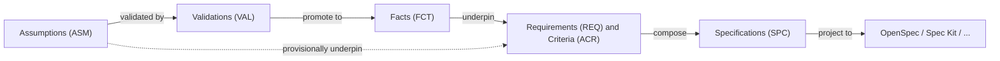

# ASDLC Meta-Specs

[](https://github.com/jvanheerikhuize/asdlc-meta-specs/actions/workflows/validate.yml)

A **standard-agnostic, epistemic specification repository** for Agentic Software Development Life Cycles (ASDLC) and Specification-Driven Development (SDD).

Instead of monolithic spec documents that silently mix verified truths with guesswork, this repository breaks specifications down into **atomic, linkable elemental records** governed by an explicit **epistemic feedback loop**:



> **Better facts → better requirements → better specs.**

---

## Core Philosophy

1. **Epistemic Transparency (Facts vs. Assumptions)**
   Every normative element — Constraint (`CON`), Requirement (`REQ`), Acceptance Criterion (`ACR`), or Decision (`DEC`) — links to the **Facts (`FCT`)** and/or **Assumptions (`ASM`)** that underpin it. The validator enforces that:
   - records underpinned by unvalidated assumptions cannot be `active` (they must be **provisional**);
   - records underpinned by an invalidated assumption or deprecated fact must be **broken** / **needs_review**;
   - records still pointing at a *promoted* assumption are flagged for review against the resulting fact.

2. **Atomic Elemental Records**
   Each record is one Markdown file with strict YAML frontmatter in `records/`. This gives clean Git diffs, no merge conflicts between unrelated requirements, stable ID addressing, and easy parsing by AI agents and future capture UIs.

3. **Standard-Agnostic Projections**
   External SDD formats — **OpenSpec**, **GitHub Spec Kit**, EARS, Gherkin, ADRs — are treated as **target projections** (`adapters/` → `dist/`) of the canonical record graph.

---

## Quickstart

```bash
pip install -r tools/requirements.txt
python tools/validate.py            # schema, links, reciprocity, epistemic consistency, readiness
python tools/validate.py --strict   # also fail on warnings
```

**Adding a record:** copy an existing record of the same type, take the next free ID (`REQ-0003`), name the file `<ID>-<kebab-slug>.md`, fill in the frontmatter, and run the validator. Dates must be quoted strings (`created_at: "2026-10-26"`).

---

## Repository Architecture

```text
asdlc-meta-specs/
├── meta-spec.config.yaml              # ID prefixes, directories, schemas, epistemic rules, adapters
├── schema/                            # JSON Schemas (Draft 2020-12) for record frontmatter
├── records/                           # Canonical atomic store (source of truth)
│   ├── epistemic/
│   │   ├── assumptions/               # ASM-xxxx: unverified hypotheses
│   │   ├── validations/               # VAL-xxxx: spikes, benchmarks, interviews, evidence
│   │   └── facts/                     # FCT-xxxx: verified truths & promoted assumptions
│   └── normative/
│       ├── constraints/               # CON-xxxx: project guardrails & invariants
│       ├── requirements/              # REQ-xxxx: atomic functional & non-functional requirements
│       ├── criteria/                  # ACR-xxxx: testable acceptance scenarios
│       └── decisions/                 # DEC-xxxx: architectural & design decisions
├── specs/
│   ├── capabilities/                  # SPC-xxxx: capability manifests composing records
│   └── changes/                       # CHG-xxxx: delta proposals (added / modified / removed)
├── adapters/                          # Mapping rules & templates per target standard
│   ├── openspec/
│   └── speckit/
├── dist/                              # Projected standard outputs (currently hand-written samples)
├── tools/                             # validate.py + requirements.txt
├── .github/workflows/validate.yml     # CI: runs the validator on every push / PR
└── docs/                              # Architecture, lifecycle & mapping guides
```

---

## Elemental Record Prefix Reference

| Prefix | Layer | Type | Description |
| :--- | :--- | :--- | :--- |
| **`ASM`** | Epistemic | `assumption` | Unverified belief with explicit `confidence`, `risk`, and `validation_plan`. |
| **`VAL`** | Epistemic | `validation` | Experiment, benchmark, test, or citation that `tests` an assumption or `establishes` a fact. |
| **`FCT`** | Epistemic | `fact` | Verified truth or invariant (native, or `promoted_from` an `ASM` via a `VAL`). |
| **`CON`** | Normative | `constraint` | Project principle, compliance boundary, or architectural invariant. |
| **`REQ`** | Normative | `requirement` | Atomic normative statement (`MUST`/`SHALL`/`SHOULD`/`MAY`). |
| **`ACR`** | Normative | `criterion` | Testable scenario (`GIVEN`/`WHEN`/`THEN` or assertion) verifying a `REQ`. |
| **`DEC`** | Normative | `decision` | Design choice / ADR satisfying `REQ`s and `CON`s. |
| **`SPC`** | Composition | `spec` | Capability specification assembling `CON`, `REQ`, `ACR`, `DEC` records. |
| **`CHG`** | Composition | `change` | Delta proposal adding, modifying, or removing records. |

---

## Project Status

| Area | Status |
| :--- | :--- |
| Record model, schemas, folder architecture | ✅ In place |
| Reference example (auth capability) | ✅ In place |
| Validator + CI | ✅ In place |
| Projection compiler (`adapters/` → `dist/`) | 🔜 Planned — `dist/` currently holds hand-written samples of the intended output |
| Capture interfaces (CLI / UI) | 🔜 Planned |

---

## Documentation

- **[Architecture & Data Model](docs/architecture.md)** — record graph, frontmatter conventions, traceability rules.
- **[Epistemic Lifecycle](docs/epistemic-lifecycle.md)** — capturing assumptions, validating, promoting to facts, cascading updates.
- **[Standard Mappings](docs/standard-mappings.md)** — how records project into OpenSpec, Spec Kit, EARS, and Gherkin.
