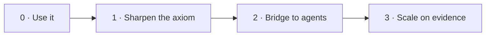

# Roadmap

This repository grows **one evidence-backed step at a time**, keeping the model minimal until real usage demonstrates a need for more.

## The reasoning

1. **Grow with the repo's own method.** The axiom is *facts → requirements → specs*. Candidate features start as **assumptions** ("we will need separate validation records", "teams need an ingest bot") and are added only when a real need has been observed and recorded as a fact.
2. **Simplicity makes the idea transferable.** The model fits in one diagram and one table. Anything added to the core model must earn its place in three places: the **check** (a rule), the **dashboard** (a state), and the **Tasks tab** (a human or agent action).
3. **Grow along the axiom, not along the architecture.** The highest-value additions strengthen the chain from facts to code: making gaps explicit (`QST`), catching stale facts, and verifying acceptance scenarios against real implementations.

## Phases

### Phase 0: Use it (in progress)

Run real projects on the record model, extract existing repositories into `records/`, and close out this repo's own open items:

- ~~**Extract a production application corpus.**~~ Done: applied to a real self-hosted media appliance (`lumen`, 36 records across 1 `skeleton` and 4 `feature` specs, passing `tools/spec.py check --strict` with 0 errors and 0 warnings).
- ~~**Interactive lineage & task triage in the workspace.**~~ Done: the static workspace (`site/`) derives actionable queues (*fix now*, *answer questions*, *test assumptions*, *quick wins*) and provides interactive left-to-right graph lineage focus.
- **Settle this repo's own open grounds (`ASM-0002` to `ASM-0004` and `QST-0002`).** These hold back `SPC-0002` (*Rendering and guardrails*). Validating or refuting them with agent runs is the next exercise of Playbook Workflows 2 and 3.

### Phase 1: Sharpen the axiom

Small additions that make the chain more truthful:

- ~~**Open questions (`QST`).**~~ Done: included in the core model (`REQ-0007`, part of `SPC-0001`). Without `QST`, the only way to record an unknown is to invent a guess (`ASM`). Resolving ambiguity before coding measurably improves generated code (`FCT-0003`, ClarifyGPT).
- **Fact freshness (`review_after` on `FCT`).** Facts about the world decay (traffic, latency, external APIs, regulations). A fact past its review date turns amber on the dashboard and appears in the Tasks queue.
- **Non-goals on `SPC`.** One optional section or field that tells implementing agents what *not* to build, preventing scope creep during autonomous runs.

### Phase 2: Bridge to agents

- ~~**Playbook workflows for agent extraction, assumption testing, and question resolution.**~~ Done: documented in [`README.md`](README.md#playbook-agent--human-workflows) with copy-pasteable prompts.
- **Separate tech-stack file (`TECH_STACK.md`) bound at render time.** Proven as a convention in consumer repositories (`TECH_STACK.md` alongside `records/` keeps all 36 records in `lumen` 100% stack-agnostic). Next step: optional `--stack TECH_STACK.md` injection in `tools/spec.py render` once a second stack re-implementation validates `ASM-0004`.
- **Projection to OpenSpec and Spec Kit** as small renderer functions in `tools/spec.py` (no template engine). Trigger: `QST-0002` answered and `ASM-0003` validated against a live consumer tool.
- **Acceptance criteria with their own IDs and code traceability.** Once tests in an implementing repo can cite `REQ-0001#1`, `tools/spec.py check` can report which active requirements lack passing code verification, closing the loop `facts → requirements → specs → tests`.

### Phase 3: Scale on evidence

Add each capability only when its trigger is observed in real usage:

| Candidate feature | Current state | Add when |
| :--- | :--- | :--- |
| `VAL` validation records | `evidence` field on `FCT` | A single fact needs multiple independent validation runs or reusable benchmark logs |
| `CON` constraints | `SHOULD`/`MUST` requirements + `TECH_STACK.md` | The same cross-cutting rule is repeated across three or more requirements |
| `DEC` decisions | Git history + `FCT`/`ASM` grounds | Architectural choices between alternatives keep getting reopened |
| `CHG` change proposals | Pull requests + `tools/spec.py impact` | A change spans many records and needs review as one unit beyond a PR |
| JSON Schemas | Rules in `tools/spec.py check` | External tools write records directly and need a machine-readable schema contract |
| Issue → bot → PR capture | GitHub web editor links from the Capture tab | Contributors without GitHub fluency hit friction, or volume makes manual PRs a bottleneck |
| `TRM` terms, `CTR` contracts | Inline definitions in `REQ`/`SPC` | Agents demonstrably drift on domain vocabulary or interfaces across specs |
| `autonomy_tier` | Human PR review | Agents act on specs without a human reviewing every pull request |

Some of these may never be needed. Every candidate is an assumption to be tested in real use.
