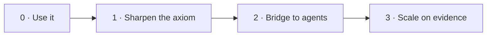

# Roadmap

This repository grows **one evidence-backed step at a time**, keeping the model minimal until real usage demonstrates a need for more.

## The reasoning

**1. Grow with the repo's own method.** The axiom here is *facts → requirements → specs*. A roadmap is a set of requirements for the repo itself, so it is subject to the same rule. Candidate features start as **assumptions** ("we will need separate validation records", "teams need an ingest bot"). A capability is added when a real need has been observed and written down as a fact, not before.

**2. Simplicity is what makes the idea transferable.** The model fits in one diagram and one table. Each addition has to be worth the explaining it costs. As a rule of thumb, anything added must also show up in the **check** (a rule), the **dashboard** (a state) and the **Tasks tab** (a human action). If it does none of these, it is documentation, not structure.

**3. Grow along the axiom, not along the architecture.** The most valuable additions make the facts-to-specs chain stronger: catching facts that go stale, making questions explicit, tracing specs to code. Additions that make the system more complete but not more truthful come later: more record types for their own sake, schemas, automation.

## Phases

### Phase 0: Use it (now)

Run a real project on this repo and record friction as assumptions (`ASM`) in `records/`. This turns the candidate list below from opinions into evidence. Close out the repo's own open assumptions (`ASM-0002` to `ASM-0004`) and its open question (`QST-0002`). They hold back `SPC-0002`, and settling them is the first real exercise of the workflow.

### Phase 1: Sharpen the axiom

Small, cheap additions that make the chain more truthful:

- ~~**Open questions (`QST`).**~~ Done: included in the core model (`REQ-0007`, part of the skeleton). An assumption is a belief with a candidate answer; a question has none yet ("ascending or descending?"). Without a question record the only way to write down a gap is to invent an assumption, which is the hidden guessing the axiom is meant to prevent. Resolving ambiguity first measurably improves generated code (`FCT-0003`, ClarifyGPT).
- **Fact freshness (`review_after` on `FCT`).** Facts about the world decay: traffic, latency, regulations. A fact past its date should turn amber on the dashboard and become a task. This applies the axiom over time.
- **Non-goals on `SPC`.** One optional field that tells agents what *not* to build. It costs almost nothing and blocks a common failure mode.

### Phase 2: Bridge to agents

- **Projection to OpenSpec and Spec Kit** as more renderer functions in `tools/spec.py`, not a template engine. Trigger: `ASM-0003` validated and a real consumer tool in use.
- **Acceptance criteria with their own IDs and code traceability.** Today scenarios live inside requirements. Once tests in an implementing repo can say `@verifies("REQ-0001#1")`, a checker can report which requirements are unproven in code. That closes the loop facts → requirements → specs → code.
- **A separate tech-stack file.** Records stay technology-free; a small file per implementation names the concrete choices (SQL, Vue, REST APIs, Azure, Azure DevOps, GitHub Copilot) and is added when rendering. Trigger: the first implementation repo consumes these specs and needs concrete technology choices bound outside the records.

### Phase 3: Scale on evidence

Add each of these only when its trigger is observed:

| Candidate feature | Current state | Add when |
| :--- | :--- | :--- |
| `VAL` validation records | `evidence` field on facts | facts need several pieces of evidence, or experiments are reused |
| `CON` constraints | `SHOULD`/`MUST` requirements, README principles | the same rule is repeated across three or more requirements |
| `DEC` decisions | none | a choice between alternatives keeps being reopened |
| `CHG` change proposals | pull requests | a change spans many records and needs review as one unit beyond a PR |
| JSON Schemas | rules in the checker | other tools write records and need a contract |
| Issue → bot → PR capture | GitHub editor from the form | contributors without GitHub fluency, or volume makes manual PRs a bottleneck |
| `TRM` terms, `CTR` contracts | none | agents demonstrably drift on vocabulary or interfaces across specs |
| `autonomy_tier` | none | agents act on specs without a human reviewing every PR |

Some of these may never be needed. That is a valid outcome: every candidate is a hypothesis to be tested in real use.
