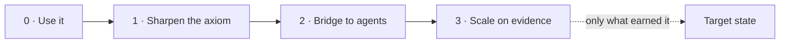

# Roadmap: from lite to target state

This repository is the **starting point**. The **target state** is the full engine originally built as `asdlc-meta-specs`, preserved in the [`target_state`](https://github.com/jvanheerikhuize/asdlc-meta-specs-lite/tree/target_state) branch (full history, tag `target_state-v1.0.0`).

The two are far apart:

| | Lite (`main`) | Target state (`target_state`) |
| :--- | :--- | :--- |
| Record types | 4 (`ASM`, `FCT`, `REQ`, `SPC`) | 10 (+ `VAL`, `QST`, `CON`, `ACR`, `DEC`, `CHG`), 2 more planned (`TRM`, `CTR`) |
| Schemas | rules inside the checker | 15 JSON Schemas + config |
| Tooling | one script, ~350 lines | five tools, ~2,300 lines |
| Projection | Markdown and Gherkin renderers | OpenSpec and Spec Kit adapters with templates, committed `dist/`, drift check |
| Capture | form → GitHub editor → PR | form → issue → bot ingestion → PR, with status cascades |
| Tech stack | warning when records name a technology | tech stack (e.g. SQL, Vue, REST APIs, Azure, Azure DevOps, GitHub Copilot) defined outside the records and added at render time |

## The reasoning

**1. Reach the target with the repo's own method.** The axiom here is *facts → requirements → specs*. A roadmap is a set of requirements for the repo itself, so it is subject to the same rule. Every piece of the target state is currently an **assumption** ("we will need separate validation records", "teams need an ingest bot"). The target state was designed up front. Most of it is plausible, but little of it has been shown to be needed. A feature moves from `target_state` to `main` when a real need has been observed and written down as a fact, not before.

**2. Simplicity is what makes the idea transferable.** The target state was hard to present because every concept arrived at once. The lite version shows the whole idea in one diagram and one table. Each addition has to be worth the explaining it costs. As a rule of thumb, anything added must also show up in the **check** (a rule), the **dashboard** (a state) and the **Tasks tab** (a human action). If it does none of these, it is documentation, not structure.

**3. Grow along the axiom, not along the architecture.** The most valuable additions make the facts-to-specs chain stronger: catching facts that go stale, making questions explicit, tracing specs to code. Additions that make the system more complete but not more truthful come later: more record types for their own sake, schemas, automation.

**4. The target state is a reference, not a merge.** The branches share no history. Treat `target_state` as a design library: read it, reuse its ideas and sometimes its code, but bring things over one at a time through normal PRs on `main`.

```bash
git show target_state:docs/roadmap.md         # the original roadmap
git diff main target_state --stat             # everything that differs
git checkout target_state -- schema/          # copy a folder over to work from
```

## Phases



### Phase 0: Use it (now)

Run a real project on the lite repo and record friction as assumptions (`ASM`) in `records/`. This turns the gap list below from opinions into evidence. Close out the repo's own open assumptions (`ASM-0002` to `ASM-0004`). They hold back `SPC-0002`, and testing them is the first real exercise of the workflow.

### Phase 1: Sharpen the axiom

Small, cheap additions that make the chain more truthful:

- **Open questions (`QST`).** An assumption is a belief with a candidate answer. A question has none yet ("ascending or descending?"). Agents guess silently when nobody records the question; resolving ambiguity first measurably improves generated code (ClarifyGPT, see README). This is the most likely first new record type. Target state reference: `schema/question.schema.json`, `blocking` cascade in `tools/validate.py`.
- **Fact freshness (`review_after` on `FCT`).** Facts about the world decay: traffic, latency, regulations. A fact past its date should turn amber on the dashboard and become a task. This applies the axiom over time.
- **Non-goals on `SPC`.** One optional field that tells agents what *not* to build. It costs almost nothing and blocks a common failure mode.

### Phase 2: Bridge to agents

- **Projection to OpenSpec and Spec Kit** as more renderer functions in `tools/spec.py`, not a template engine. Trigger: `ASM-0003` validated and a real consumer tool in use. Reference: `adapters/`, `tools/project.py`.
- **Acceptance criteria with their own IDs and code traceability.** Today scenarios live inside requirements. Once tests in an implementing repo can say `@verifies("REQ-0001#1")`, a checker can report which requirements are unproven in code. That closes the loop facts → requirements → specs → code. Reference: planned `tools/verify_coverage.py`.
- **A separate tech-stack file.** Records stay technology-free; a small file per implementation names the concrete choices (SQL, Vue, REST APIs, Azure, Azure DevOps, GitHub Copilot) and is added when rendering. Trigger: the first implementation repo consumes these specs and needs concrete technology choices bound outside the records.

### Phase 3: Scale on evidence

Add each of these only when its trigger is observed:

| Target-state feature | Lite today | Add when |
| :--- | :--- | :--- |
| `VAL` validation records | `evidence` field on facts | facts need several pieces of evidence, or experiments are reused |
| `CON` constraints | `SHOULD`/`MUST` requirements, README principles | the same rule is repeated across three or more requirements |
| `DEC` decisions | none | a choice between alternatives keeps being reopened |
| `CHG` change proposals | pull requests | a change spans many records and needs review as one unit beyond a PR |
| JSON Schemas | rules in the checker | other tools write records and need a contract |
| Issue → bot → PR capture | GitHub editor from the form | contributors without GitHub fluency, or volume makes manual PRs a bottleneck |
| `TRM` terms, `CTR` contracts | none | agents demonstrably drift on vocabulary or interfaces across specs |
| `autonomy_tier` | none | agents act on specs without a human reviewing every PR |

Some of these may never be needed. That is a valid outcome. The target state is a hypothesis about where this goes, and this roadmap is how it gets tested.

## Retiring the old repository

Everything in `asdlc-meta-specs` is in `target_state`, including history and the `v1.0.0` tag (as `target_state-v1.0.0`). What a branch cannot carry over: its GitHub issues (six closed capture issues), pull request discussions and its Pages deployment. Archive the repository instead of deleting it if those should stay readable.
