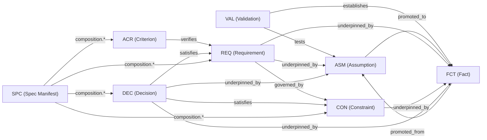

# Architecture & Canonical Meta-Model

This document defines the canonical data model, file conventions, and graph relationships of `asdlc-meta-specs`.

---

## 1. The Three Architectural Layers

The repository separates **what we believe or know about the world** (Epistemic Layer) from **what the system must do** (Normative Layer) and **how specifications are packaged for external tools** (Composition & Projection Layer).

| Layer | Directory | Record Types | Role |
| :--- | :--- | :--- | :--- |
| **1. Epistemic** | `records/epistemic/` | `ASM`, `VAL`, `FCT` | Establishes truth, tracks uncertainty, and records validation evidence. |
| **2. Normative** | `records/normative/` | `CON`, `REQ`, `ACR`, `DEC` | Defines atomic behavioral requirements, verification criteria, guardrails, and architectural decisions. |
| **3. Composition & Projection** | `specs/`, `adapters/`, `dist/` | `SPC`, `CHG` | Assembles atomic records into capability specs or change deltas and compiles them into target standards (`openspec`, `speckit`). |

---

## 2. File Naming & Format Convention

Every elemental record is stored as an individual Markdown file (`.md`) with a strict YAML frontmatter block:

```text
<directory>/<PREFIX>-<4-DIGIT-ID>-<kebab-case-slug>.md
```

Examples:
- `records/epistemic/assumptions/ASM-0001-token-ttl.md`
- `records/epistemic/validations/VAL-0001-auth-load-spike.md`
- `records/epistemic/facts/FCT-0001-stateless-jwt-limit.md`
- `records/normative/requirements/REQ-0001-session-expiration.md`
- `records/normative/criteria/ACR-0001-expired-token-rejection.md`

### Why Markdown + YAML Frontmatter?
1. **Atomic Git Operations**: Adding, modifying, or promoting a single record touches a concise, isolated file—preventing merge conflicts across concurrent agents or engineers.
2. **Deterministic Graph Traversal**: Frontmatter fields (`id`, `underpinned_by`, `verifies`, `promoted_to`, etc.) form an explicit directed graph that can be validated against `schema/*.schema.json` or indexed into SQLite/in-memory graphs in milliseconds.
3. **Rich Narrative Body**: The Markdown body supports structured sections (`## Statement`, `## Rationale`, `## Scenario`, tables, math, and diagrams) without escaping multiline YAML strings.

---

## 3. Directed Graph Relationships

Every link between records is typed and directional:



### Bidirectional Traceability Rules
To ensure both fast local reading and global graph integrity:
- **Upward Grounding (`underpinned_by`)**: Normative records (`CON`, `REQ`, `DEC`) **must** declare `underpinned_by: [FCT-xxxx | ASM-xxxx]`. No requirement may exist in a vacuum without an epistemic justification.
- **Verification Binding (`verified_by` / `verifies`)**: Active requirements link to their acceptance criteria via `verified_by: [ACR-xxxx]`, and criteria link back via `verifies: [REQ-xxxx]`.
- **Promotion Lineage (`promoted_to` / `promoted_from`)**: When an assumption is validated, the original `ASM` record is preserved with `status: promoted` and `promoted_to: [FCT-xxxx]`, while the new `FCT` record points back via `promoted_from: ASM-xxxx`.
