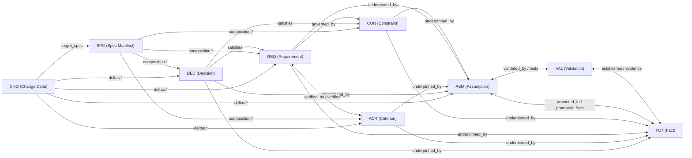

# Architecture & Canonical Meta-Model

This document defines the canonical data model, file conventions, and graph relationships of `asdlc-meta-specs`.

---

## 1. The Three Architectural Layers

The repository separates **what we believe or know about the world** (Epistemic Layer) from **what the system must do** (Normative Layer) and **how specifications are packaged for external tools** (Composition & Projection Layer).

| Layer | Directory | Record Types | Role |
| :--- | :--- | :--- | :--- |
| **1. Epistemic** | `records/epistemic/` | `ASM`, `VAL`, `FCT` | Establishes truth, tracks uncertainty, and records validation evidence. |
| **2. Normative** | `records/normative/` | `CON`, `REQ`, `ACR`, `DEC` | Defines atomic behavioral requirements, verification criteria, guardrails, and architectural decisions. |
| **3. Composition & Projection** | `specs/`, `adapters/`, `dist/` | `SPC`, `CHG` | Assembles atomic records into capability specs or change deltas and compiles them into target standards (`openspec`, `speckit`). |

---

## 2. File Naming & Format Convention

Every elemental record is stored as an individual Markdown file (`.md`) with a strict YAML frontmatter block:

```text
<directory>/<PREFIX>-<4-DIGIT-ID>-<kebab-case-slug>.md
```

Examples from this repository:
- `records/epistemic/assumptions/ASM-0001-token-validation-load.md`
- `records/epistemic/validations/VAL-0001-gateway-traffic-replay.md`
- `records/epistemic/facts/FCT-0001-burst-token-verification-rate.md`
- `records/normative/constraints/CON-0001-zero-trust-hot-path.md`
- `records/normative/requirements/REQ-0001-stateless-token-verification.md`
- `records/normative/criteria/ACR-0001-expired-token-rejection.md`
- `records/normative/decisions/DEC-0001-eddsa-jwt-access-tokens.md`
- `specs/capabilities/SPC-0001-authentication.md`
- `specs/changes/CHG-0001-add-revocation-denylist.md`

### Why Markdown + YAML Frontmatter?
1. **Atomic Git Operations**: Adding, modifying, or promoting a single record touches a concise, isolated file—preventing merge conflicts across concurrent agents or engineers.
2. **Deterministic Graph Traversal**: Frontmatter fields (`id`, `underpinned_by`, `verifies`, `promoted_to`, etc.) form an explicit directed graph that can be validated against `schema/*.schema.json` or compiled into `site/data/index.json` in milliseconds.
3. **Rich Narrative Body**: The Markdown body supports structured `## <Heading>` sections (`## Statement`, `## Rationale`, `## Scenario: <title>`, `## Findings`, `## Context`, `## Decision`, etc.) parsed into key-value sections by `tools/recordlib.py` without escaping multiline YAML strings.

---

## 3. Directed Graph Relationships

Every link between records is typed and directional:



### Bidirectional Traceability & Graph Integrity Rules
`tools/validate.py` enforces strict referential integrity and reciprocity across the graph:
1. **Upward Grounding (`underpinned_by`)**: Normative records (`CON`, `REQ`, `DEC`) **must** declare a non-empty `underpinned_by: [FCT-xxxx | ASM-xxxx]` array (`ACR` may optionally declare `underpinned_by` when scenario thresholds depend on specific facts or assumptions). No requirement, constraint, or decision may exist without an epistemic justification.
2. **Enforced Reciprocal Link Pairs**: Whenever one side of a reciprocal link is declared, `validate.py` verifies that the target record links back:
   - **Promotion Lineage**: `ASM.promoted_to` $\leftrightarrow$ `FCT.promoted_from`
   - **Validation Coverage**: `ASM.validated_by` $\leftrightarrow$ `VAL.tests`
   - **Fact Evidence**: `VAL.establishes` $\leftrightarrow$ `FCT.evidence`
   - **Acceptance Coverage**: `REQ.verified_by` $\leftrightarrow$ `ACR.verifies`
3. **Active Requirement Verification**: When `epistemic_rules.require_criteria_for_active_requirements` is enabled in `meta-spec.config.yaml`, any `REQ` with `status: active` must reference at least one `ACR-xxxx` in `verified_by`.
4. **Evolution & Hierarchy Links**:
   - `FCT.supersedes: [FCT-xxxx]` and `DEC.supersedes: [DEC-xxxx]` track replaced facts and decisions (setting the older record's `status` to `superseded`).
   - `REQ.parent: REQ-xxxx` supports optional hierarchical requirement decomposition.

---

## 4. Record Schemas & Lifecycle Statuses

All frontmatter is validated against Draft 2020-12 JSON Schemas in `schema/`. Every record shares the common envelope in `schema/base-record.schema.json` (`id`, `type`, `title`, `domain`, `status`, `owners`, `tags`, `created_at`, `updated_at`) plus type-specific fields:

| Prefix | Type | Schema | Allowed `status` Values | Key Type-Specific Fields |
| :--- | :--- | :--- | :--- | :--- |
| **`ASM`** | `assumption` | `assumption.schema.json` | `unvalidated`, `validating`, `promoted`, `invalidated`, `retired` | `confidence` (`0.0`–`1.0`), `risk` (`low`\|`medium`\|`high`\|`critical`), `validation_plan`, `validated_by`, `promoted_to` |
| **`VAL`** | `validation` | `validation.schema.json` | `planned`, `in_progress`, `completed`, `aborted` | `method`, `outcome` (`pending`\|`confirmed`\|`refined`\|`refuted`), `tests`, `establishes`, `artifacts` |
| **`FCT`** | `fact` | `fact.schema.json` | `active`, `superseded`, `deprecated` | `source`, `promoted_from`, `evidence`, `supersedes` |
| **`CON`** | `constraint` | `constraint.schema.json` | `draft`, `provisional`, `active`, `needs_review`, `deprecated` | `scope` (`global`\|`domain`\|`security`\|`performance`\|`compliance`), `enforcement` (`mandatory`\|`advisory`), `underpinned_by` |
| **`REQ`** | `requirement` | `requirement.schema.json` | `draft`, `provisional`, `active`, `needs_review`, `broken`, `deprecated` | `category`, `normative` (`MUST`\|`SHALL`\|`SHOULD`\|`MAY`), `ears_pattern`, `priority` (`p0`–`p3`), `underpinned_by`, `governed_by`, `verified_by`, `parent` |
| **`ACR`** | `criterion` | `criterion.schema.json` | `draft`, `provisional`, `active`, `needs_review`, `deprecated` | `format` (`gherkin`\|`invariant`\|`metric_threshold`\|`checklist`), `verifies`, `underpinned_by` |
| **`DEC`** | `decision` | `decision.schema.json` | `proposed`, `provisional`, `accepted`, `needs_review`, `superseded`, `rejected` | `satisfies` (`REQ`/`CON`), `underpinned_by`, `supersedes` |
| **`SPC`** | `spec` | `spec-manifest.schema.json` | `draft`, `provisional`, `active`, `needs_review`, `merged`, `archived` | `composition.{constraints,requirements,criteria,decisions}` |
| **`CHG`** | `change` | `spec-manifest.schema.json` | `draft`, `provisional`, `active`, `needs_review`, `merged`, `archived` | `target_spec` (`SPC-xxxx`), `deltas.{added,modified,removed}` |

---

## 5. Tooling, Capture Pipeline & Workspace Architecture

### Python Tooling (`tools/`)
- **`tools/recordlib.py`**: Shared library that loads `meta-spec.config.yaml`, iterates canonical record files, splits YAML frontmatter and `## <Heading>` Markdown sections, and serializes records back to disk with ISO date strings preserved.
- **`tools/validate.py`**: Validates every record against `schema/*.schema.json`, checks file placement and ID uniqueness, verifies that all link targets exist, enforces the 4 reciprocal link rules, checks epistemic consistency between normative statuses and their underpinnings, enforces tech-stack agnosticism on specifications and normative records, and reports per-`SPC` Epistemic Readiness scores.
- **`tools/build_index.py`**: Compiles the canonical record graph into `site/data/index.json` (respecting `site.publish: "full" | "metadata"` in `meta-spec.config.yaml`).
- **`tools/ingest_capture.py`**: Parses untrusted capture submissions from GitHub Issue Forms (`.github/ISSUE_TEMPLATE/capture-*.yml`) or JSON/YAML payload files, validates them against `schema/captures/<kind>.capture.schema.json`, allocates collision-free IDs (accounting for open `capture/*` branches), writes new records, and cascades updates to existing records.

### GitHub Pages Workspace (`site/`)
`site/` is a zero-build, dependency-free Single-Page Application using ES modules and safe DOM construction (`site/js/dom.js`):
- **Stratified Record Graph (`site/js/views/graph.js`, `#/graph`)**: Canonicalizes reciprocal links into a 5-column epistemic-to-normative flow (`1 · Hypotheses & Evidence` $\rightarrow$ `2 · Verified Truths` $\rightarrow$ `3 · Normative Core` $\rightarrow$ `4 · Verification & Design` $\rightarrow$ `5 · Composition`), applies barycenter crossing reduction, highlights upstream grounding and downstream impact chains via BFS (`computeLineage`), and embeds a neighborhood mini-graph on every `#/record/:id` page.
- **Schema-Driven Capture Engine (`site/js/capture/`)**: Renders guided forms for `requirement`, `assumption`, `fact` (including validation, promotion, and refutation), and `decision`, complete with live preview, non-blocking quality hints (`text.js`), `localStorage` draft autosave, and URL pre-filling into `.github/ISSUE_TEMPLATE/capture-*.yml`.

---

## 6. Tech-Stack Agnosticism (PIM vs. PSM Separation)

Canonical specifications in this repository represent a **Platform-Independent Model (PIM)**. Concrete technology stacks (programming languages, frameworks, database engines, wire protocols, and cryptographic cipher suites) are defined externally in a **Platform-Specific Model (PSM)** and bound only during target projection.

| Record Types | Agnosticism Rule |
| :--- | :--- |
| **`CON`, `REQ`, `ACR`, `SPC`, `CHG`** | **Strictly tech-stack agnostic.** Titles, statements, scenarios, and scope sections are checked by `tools/validate.py` against `epistemic_rules.forbidden_tech_terms` in `meta-spec.config.yaml` and by `site/js/capture/text.js` during capture. |
| **`DEC`** | **Pattern-level architectural topology.** Captures abstract patterns (e.g., *Asymmetric Self-Contained Access Credentials* vs. *Opaque Session Identifiers*) rather than vendor libraries or specific cipher suites. |
| **`ASM`, `FCT`** | **Domain & operational invariants.** Expresses traffic rates, latency bounds, and user/system behavior in stack-neutral terms. |
| **`VAL`** | **Empirical evidence.** May reference concrete benchmark rigs or measurement harnesses as historical test context without making those tools normative requirements. |

See [Roadmap & Planned Evolution](roadmap.md) for how planned record types (`TRM-xxxx`, `QST-xxxx`, `CTR-xxxx`) and the projection compiler extend this separation.


