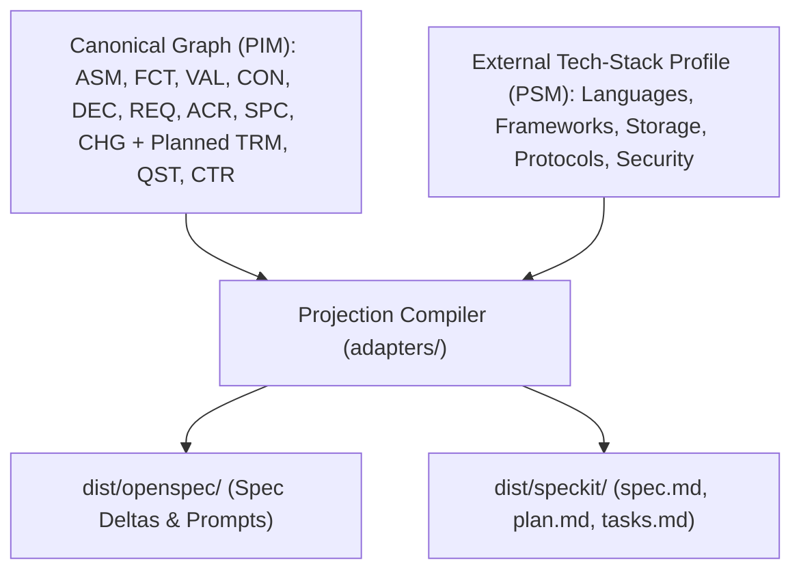

# Roadmap & Planned Evolution

This document tracks the planned evolution of the **Agentic SDLC Meta-Spec Engine**, including upcoming tech-stack-agnostic record types, schema enrichments, projection tooling, and workspace capabilities.

---

## Architectural Guiding Principle: PIM vs. PSM Separation

In an Agentic SDLC, AI coding agents suffer from **premature implementation anchoring** when canonical specifications mix *domain intent* with *vendor/framework syntax*. Furthermore, when a system migrates its underlying technology stack (for example, moving from REST to gRPC, or from one datastore to another), its domain requirements, constraints, and acceptance criteria remain unchanged.

To keep specifications durable and reusable across stacks, the repository enforces a strict separation inspired by **Model-Driven Architecture (MDA)**:

1. **Platform-Independent Model (PIM) — This Repository (`records/`, `specs/`)**
   - **Normative (`CON`, `REQ`, `ACR`, `DEC`)**, **Epistemic (`ASM`, `FCT`)**, and **Composition (`SPC`, `CHG`)** records define *what* the system must achieve, *why* a pattern was chosen, and *how* behavior is verified in **strictly tech-stack-agnostic domain language**.
   - `VAL` records may note concrete benchmark harness environments strictly as empirical test metadata without making those tools normative requirements.
2. **Platform-Specific Model (PSM) — External Tech-Stack Profile & Adapters (`adapters/`, `dist/`)**
   - Concrete frameworks, languages, databases, wire protocols, and cryptographic cipher suites are defined **outside** the normative records (e.g., in an external Tech-Stack Profile or target repository constitution).
   - Projection adapters combine the tech-stack-agnostic `SPC`/`CHG` graph with the external tech-stack profile to emit stack-bound execution plans (`plan.md`, `tasks.md`) into `dist/`.

---

## 1. Planned Tech-Stack-Agnostic Record Types

When evaluating the specification graph holistically for autonomous coding agents, three additional tech-stack-agnostic record types are planned to eliminate hallucination vectors:

### 1.1 `TRM-xxxx` — Domain Term / Ubiquitous Language (`records/normative/terms/`)

- **Problem**: Agents frequently invent inconsistent terminology across modules (`User`, `Account`, `Principal`, `Subject`, or `Session` vs. `CredentialGrant`), causing subtle semantic drift across requirements and code.
- **Tech-Stack-Agnostic Role**: Defines the pure domain concept, its invariants, and its forbidden synonyms—never database table names or language-specific types.
- **Planned Frontmatter & Sections**:
  - `id`: `TRM-0001`
  - `type`: `term`
  - `domain`: `<domain>`
  - `canonical_identifier`: `AccessCredential`
  - `forbidden_synonyms`: `["TokenString", "AuthHeader", "SessionBlob"]`
  - `related_records`: `["REQ-0001", "SPC-0001"]`
  - **Markdown Sections**: `## Definition`, `## Domain Invariants`, `## Disambiguation`

### 1.2 `QST-xxxx` — Open Question / Clarification (`records/epistemic/questions/`)

- **Problem**: When an agent or human encounters an underspecified edge case, they must not silently guess. Currently, Spec-Kit projections rely on inline `[NEEDS CLARIFICATION]` text markers, which are invisible to graph queries (`validate.py`, `build_index.py`) and cannot systematically block specification promotion.
- **Tech-Stack-Agnostic Role**: Tracks domain or behavioral ambiguities as first-class epistemic graph nodes until resolved by a Fact (`FCT`), Assumption (`ASM`), Decision (`DEC`), or Requirement (`REQ`).
- **Planned Frontmatter & Sections**:
  - `id`: `QST-0001`
  - `type`: `question`
  - `domain`: `<domain>`
  - `status`: `open` | `answered` | `deferred`
  - `blocking`: `true` | `false` (when `true`, `validate.py` prevents the parent `SPC` or `CHG` from transitioning out of `draft`/`proposed`)
  - `affects`: `["REQ-0002", "SPC-0001"]`
  - `resolved_by`: `["DEC-0001"]`
  - **Markdown Sections**: `## Question`, `## Options Under Consideration`, `## Resolution`

### 1.3 `CTR-xxxx` — Logical Domain & Interaction Contract (`records/normative/contracts/`)

- **Problem**: Agents need formal boundaries for inputs, outputs, preconditions, postconditions, and failure modes between capabilities, but traditional interface definitions (OpenAPI, Protobuf, GraphQL, SQL DDL) prematurely lock in a wire protocol or storage engine.
- **Tech-Stack-Agnostic Role**: Defines a **Logical Operation Contract** using abstract domain types (referencing `TRM-xxxx` records), logical preconditions/postconditions, idempotency guarantees, and logical error states.
  - *Example*: Operation `VerifyAccessCredential` accepts `AccessCredential`, returns `SubjectIdentity | VerificationFailure(Expired | Revoked | Malformed)`, and is logically idempotent and side-effect-free.
  - External stack adapters later bind `CTR-xxxx` to REST endpoints, gRPC methods, message bus events, or local function signatures.
- **Planned Frontmatter & Sections**:
  - `id`: `CTR-0001`
  - `type`: `contract`
  - `domain`: `<domain>`
  - `satisfies`: `["REQ-0001"]`
  - `terms_used`: `["TRM-0001"]`
  - **Markdown Sections**: `## Operation Signature (Logical)`, `## Preconditions & Invariants`, `## Postconditions`, `## Logical Error States`

---

## 2. Planned Schema Enrichments on Existing Records

To strengthen agent guardrails without adding ceremony, the following optional fields are planned for existing schemas:

| Record Type | Planned Field / Section | Purpose |
| :--- | :--- | :--- |
| **`SPC-xxxx` / `CHG-xxxx`** | `non_goals` + `## Out of Scope / Non-Goals` | Explicitly bounds what agents **must not** build or refactor when implementing a capability or change (preventing scope creep and unsolicited "helpful" features). |
| **`FCT-xxxx`** | `valid_until` / `review_after_days` | Enables `tools/validate.py` to flag **epistemic rot** when operational facts (such as traffic volume or latency baselines) pass their freshness window without re-verification. |
| **`CON-xxxx` / `REQ-xxxx` / `SPC-xxxx`** | `autonomy_tier`: `autonomous` \| `human_review_required` \| `human_only` | Signals to downstream agent orchestrators whether an agent can autonomously modify behavior satisfying a requirement or must request human sign-off. |

---

## 3. Tooling & Workspace Milestones

### 3.1 Projection Compiler Extensions (`tools/project.py`)
- **Implemented (`✅`)**: [`tools/project.py`](../tools/project.py) compiles `SPC-xxxx`, `CHG-xxxx`, `CON-xxxx`, and `FCT-xxxx` records through [`adapters/openspec/mapping.yaml`](../adapters/openspec/mapping.yaml) and [`adapters/speckit/mapping.yaml`](../adapters/speckit/mapping.yaml) into `dist/openspec/` and `dist/speckit/` (including `--check` drift detection and `--stack-profile <yaml>` PSM binding).
- **Planned Next**: Extend `adapters/speckit/` to emit `dist/speckit/specs/<number>-<domain>/tasks.md` with ordered implementation tasks traceable to `REQ-xxxx`, `ACR-xxxx`, and `CTR-xxxx` IDs.

### 3.2 Closed-Loop Code & Test Traceability (`tools/verify_coverage.py`)
- Scan target implementation repositories for `@verifies("ACR-xxxx")` and `@implements("REQ-xxxx")` annotations in test suites and source files, closing the loop between `ACR-xxxx` acceptance criteria, `VAL-xxxx` validation records, and executable tests.

### 3.3 In-App Pull Request Review & Approval (`site/`)
- Extend the browser workspace so reviewers can inspect open ingestion Pull Requests (`ingest/*` branches), preview graph diffs and `validate.py` results, and approve/merge PRs directly from the web UI.
